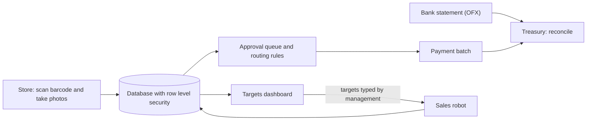

# Receiving and finance app (PWA)

> **Finance & store operations** · In production
>
> Parte do meu portfólio / Part of my portfolio: [portfolio-automacoes](https://github.com/Rapunzelmina/portfolio-automacoes) · [Português](#português) · [English](#english)

## Como funciona / How it works

## Português

### App de recebimento e financeiro (PWA)

**Área:** Financeiro e operação das lojas · **Status:** Em produção

#### Problema

As lojas recebiam notas e boletos em papel, WhatsApp e e-mail, sem um registro único. Aprovação de pagamentos, borderô, conciliação bancária e acompanhamento de metas viviam em planilhas separadas.

#### Solução

Um aplicativo instalável no celular, num único lugar, com login por usuário e perfis de acesso. Na loja: leitura do código de barras da nota (chave de 44 dígitos) e fotos da nota e do boleto. Para o financeiro: fila de aprovação com regras de roteamento, borderô de pagamentos, **tesouraria** (importa o extrato do banco em OFX e concilia automaticamente com o que o ERP marcou como pago, separando o que bateu, o que está só no banco e o que está só no ERP) e **painel de metas**, com três visões: ciclos por loja, um painel com ranking, mix de categorias, comparação com o ano anterior e pontos de atenção, e uma aba de projeção só para a diretoria, onde as metas mensais por loja e por categoria são digitadas e **voltam para o robô de vendas**, que as grava nas planilhas e nos PDFs.

#### Tecnologias

- HTML, CSS e JavaScript puro (PWA)
- Supabase (Auth, PostgreSQL, Storage, row level security)
- zxing-wasm (código de barras)
- PDF.js e SheetJS
- Vercel

#### Resultado

Um registro único das notas, aprovação com histórico, conciliação bancária e metas acessíveis no celular, com cada pessoa vendo só o que o seu perfil permite.

#### O que eu fiz

Desenhei as telas e os perfis a partir da rotina real das lojas e do financeiro, e pesquisei e implementei a leitura de código de barras, a importação de extrato OFX para a conciliação e o painel de metas, fechando o ciclo entre o aplicativo e o robô de vendas.

## English

### Receiving and finance app (PWA)

**Area:** Finance & store operations · **Status:** In production

#### Problem

Stores received invoices and payment slips on paper, WhatsApp and e-mail, with no single record. Payment approval, payment batches, bank reconciliation and target tracking lived in separate spreadsheets.

#### Solution

An installable phone app in one place, with per-user login and access roles. In the store: scanning the invoice barcode (44-digit key) and photographing the invoice and payment slip. For finance: an approval queue with routing rules, a payment batch, **treasury** (imports the bank statement in OFX and reconciles it against what the ERP marked as paid, separating what matched, what is only in the bank and what is only in the ERP) and a **targets dashboard** with three views: cycles per store, a panel with ranking, category mix, year-over-year comparison and attention points, and a projection tab only for management, where monthly targets per store and category are entered and **flow back to the sales robot**, which writes them into the spreadsheets and PDFs.

#### Tech

- HTML, CSS e JavaScript puro (PWA)
- Supabase (Auth, PostgreSQL, Storage, row level security)
- zxing-wasm (código de barras)
- PDF.js e SheetJS
- Vercel

#### Result

A single record of invoices, approval with history, bank reconciliation and targets on the phone, with each person seeing only what their role allows.

#### What I did

I designed the screens and roles from the real routine of the stores and finance, and researched and implemented barcode scanning, OFX statement import for reconciliation and the targets dashboard, closing the loop between the app and the sales robot.

---

*Código-fonte privado: contém integrações e informações do ambiente corporativo. Este repositório apresenta o projeto como um *case* técnico de portfólio e não contém código, credenciais, dados de clientes, nomes de lojas ou fornecedores, nem URLs ou números internos.*

*Source code is private: it contains integrations and information from the corporate environment. This repository presents the project as a technical portfolio case study and contains no code, credentials, customer data, store or supplier names, or internal URLs or figures.*
